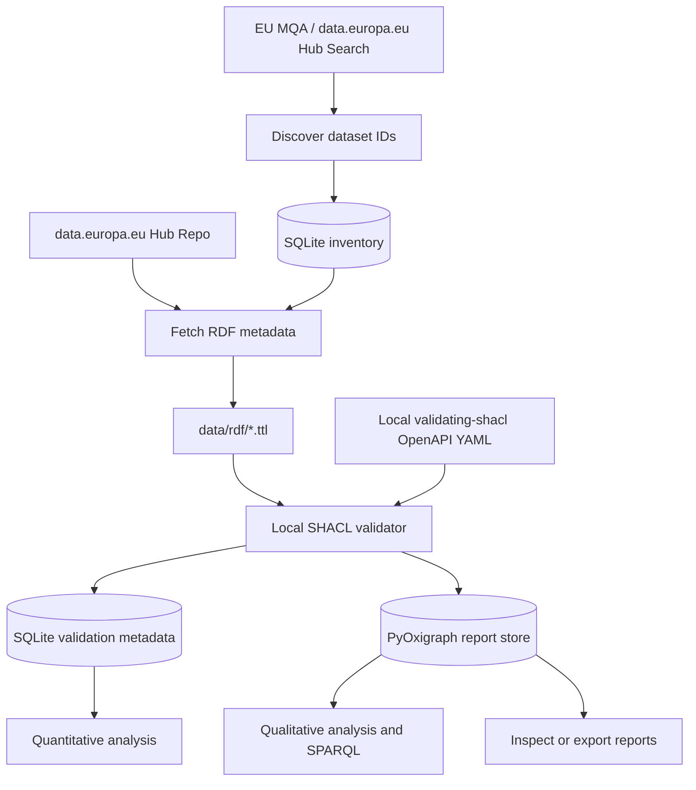

# DCAT-AP Cross-Version Validator for EU MQA

**Version:** 1.0.0  
**Command-line interface:** `dcat-ap-cv`

A Python command-line tool for collecting, validating, storing, and analysing the RDF metadata of datasets in the Italian `dati-gov-it` catalogue indexed by the [data.europa.eu](https://data.europa.eu/) piveau Hub.

The project submits each retrieved RDF dataset to multiple DCAT-AP SHACL shape models exposed by a local instance of the EU MQA SHACL validator. It records the validation outcome and stores the complete RDF validation report. The collected results can then be inspected with the CLI, queried with SPARQL, or processed through quantitative and qualitative analysis workflows.

**The project does not implement SHACL validation itself.** It acts as a client and orchestration layer for the separate [`validating-shacl`](https://gitlab.com/dataeuropa/mqa/validating-shacl) service. A working local instance of that service is required to run validations.

## Contents

- [What the project does](#what-the-project-does)
- [Requirements](#requirements)
- [Installation](#installation)
- [Configuration](#configuration)
- [Quick start](#quick-start)
- [Command reference](#command-reference)
- [How validation works](#how-validation-works)
- [Data storage](#data-storage)
- [Inspecting and exporting validation reports](#inspecting-and-exporting-validation-reports)
- [Analysis](#analysis)
- [Provided queries](#provided-queries)
- [Project layout](#project-layout)
- [Reproducibility, reset, and migration](#reproducibility-reset-and-migration)
- [Troubleshooting](#troubleshooting)
- [Tests](#tests)
- [License](#license)

## What the project does

The workflow is split into independent stages. Each stage can be run separately and resumed without repeating successful work from the previous stages.



| Stage | Description | Main output |
|---|---|---|
| Catalogue discovery | Retrieves dataset identifiers from the piveau Hub Search API. Discovery can cover the full catalogue or selected categories. | Dataset inventory in `analysis.db` |
| RDF acquisition | Downloads the RDF metadata for identifiers already present in the local inventory. | One local RDF file per dataset in `data/rdf/` |
| SHACL validation | Sends each local RDF file to the local SHACL validator for the shape models listed in its local OpenAPI specification. Requests are sequential. | Validation metadata in SQLite and complete RDF reports in PyOxigraph |
| Report inspection | Reads stored SHACL reports, displays individual results, exports Turtle files, or executes read-only SPARQL queries. | JSON, RDF/Turtle, TSV, or JSON query output |
| Analysis | Generates quantitative summaries from SQLite and qualitative summaries from the RDF report store. | CSV, JSON, and (for quantitative analysis) PNG files |

The catalogue is identified by the Hub catalogue ID `dati-gov-it` by default. The project retrieves metadata from the piveau Hub; it does **not** download directly from `dati.gov.it`.

The first four stages are deliberately separate. For example, `validation run` never performs discovery or downloads RDF files, and `datasets fetch` never starts a validation.

## Requirements

- **Python 3.10 or later.**
- Internet access to `data.europa.eu` for catalogue discovery and RDF acquisition.
- A locally running instance of the [EU MQA SHACL validator](https://gitlab.com/dataeuropa/mqa/validating-shacl), reachable through its HTTP validation endpoint.
- The `openapi-shacl.yaml` file belonging to the local validator checkout. The project reads this file to discover the supported `shapeModel` values; it does not download the file or use an embedded fallback.
- Enough disk space for the RDF cache and the PyOxigraph report store. A full catalogue run can generate a large number of RDF files and validation reports.

The analysis commands operate on the local SQLite database and/or PyOxigraph store. They do not need to contact the Hub or the validator, provided the required local data already exists.

## Installation

Run the following commands from the project root directory:

```bash
python3 -m venv .venv
source .venv/bin/activate
python -m pip install --upgrade pip
python -m pip install -e .
```

On Windows PowerShell, activate the environment with:

```powershell
.venv\Scripts\Activate.ps1
```

The editable installation installs the runtime dependencies declared in `pyproject.toml` and registers the `dcat-ap-cv` command. The same CLI can be invoked without installing the console script by running:

```bash
python -m src --help
```

The console script and `python -m src` use the same command hierarchy. Run commands from the project root unless you have configured all filesystem paths explicitly: default paths are relative to the current working directory.

## Configuration

The application uses the following defaults:

| Setting | Environment variable | Default | Purpose |
|---|---|---|---|
| SQLite database | `MQA_DB_PATH` | `analysis.db` | Dataset inventory and validation metadata |
| RDF cache directory | `MQA_RDF_DIR` | `data/rdf` | Downloaded dataset metadata |
| PyOxigraph store directory | `MQA_REPORT_STORE_PATH` | `data/validation-reports` | Complete SHACL reports and the report catalog |
| Local validator endpoint | `MQA_SHACL_VALIDATOR_URL` | `http://localhost:8080/shacl/validation/report` | HTTP endpoint used by `validation run` |
| Validator request timeout | `MQA_SHACL_VALIDATOR_TIMEOUT` | `120` seconds | Timeout for each SHACL validation request |
| Local validator OpenAPI file | `MQA_SHACL_OPENAPI` | `./openapi-shacl.yaml` | YAML file from which supported shape models are discovered |

Set environment variables before running the relevant commands. For example:

```bash
export MQA_SHACL_VALIDATOR_URL="http://localhost:8080/shacl/validation/report"
export MQA_SHACL_VALIDATOR_TIMEOUT=180
export MQA_SHACL_OPENAPI="/absolute/path/to/validating-shacl/openapi-shacl.yaml"
export MQA_DB_PATH="/absolute/path/to/experiment/analysis.db"
export MQA_RDF_DIR="/absolute/path/to/experiment/rdf"
export MQA_REPORT_STORE_PATH="/absolute/path/to/experiment/validation-reports"
```

`MQA_SHACL_OPENAPI` is resolved as a local filesystem path. If it is not set, the application looks for `openapi-shacl.yaml` in the current working directory. If the file is missing, unreadable, invalid YAML, or does not contain any supported `shapeModel` values, validation startup fails.

`MQA_SHACL_VALIDATOR_URL` and `MQA_SHACL_VALIDATOR_TIMEOUT` affect validation requests. `MQA_DB_PATH`, `MQA_RDF_DIR`, and `MQA_REPORT_STORE_PATH` select the local persistence locations used by the relevant commands. The quantitative and qualitative analysis commands also provide `--db` and `--store` options, which override the corresponding configured paths for that invocation.

Hub Search and Hub Repo requests use a 60-second timeout and retry selected transient HTTP failures (including 429 and 5xx responses) up to three times. These network settings are not configurable through the CLI in this version. The Hub Search and Hub Repo base URLs are also fixed in the application configuration.

### Local SHACL validator

The default endpoint is:

```text
http://localhost:8080/shacl/validation/report
```

The local service must accept `POST` requests to that endpoint, with the `shapeModel` query parameter and a Turtle RDF request body. Follow the installation and runtime instructions in the upstream [`validating-shacl`](https://gitlab.com/dataeuropa/mqa/validating-shacl) project to deploy the service. This repository does not bundle the validator or its Docker/JAR deployment.

The OpenAPI YAML file used by the local service must correspond to the validator deployment being tested. The profile list is read locally from that file, so the validator implementation and the OpenAPI specification should be kept in sync.

## Quick start

First check which categories are currently exposed by Hub Search:

```bash
dcat-ap-cv catalogue categories
```

For a small test run, discover a limited number of datasets in one category, fetch their RDF metadata, and validate them:

```bash
# Replace ENVI with a category ID returned by the previous command.
dcat-ap-cv catalogue discover --category ENVI --limit 3

dcat-ap-cv datasets fetch --limit 3

dcat-ap-cv validation run --limit 3
```

Inspect one validation report using the dataset identifier returned by the inventory and a shape model discovered from the local OpenAPI file (replace the example identifier if it is not available in your installation):

```bash
dcat-ap-cv reports show \
  --dataset-id "<DATASET_ID>" \
  --profile dcatap301level1
```

Run both analysis branches after the validation data has been collected:

```bash
dcat-ap-cv analysis all --out analysis-output
```

For a complete catalogue run, omit the discovery and processing limits:

```bash
dcat-ap-cv catalogue discover
dcat-ap-cv datasets fetch
dcat-ap-cv validation run
```

The commands process the local queues. Re-running them does not normally repeat successful fetches or completed validations. Failed or incomplete work remains eligible for a later attempt.

## Command reference

Use `dcat-ap-cv --help` or append `--help` to any command to see its options.

### Catalogue discovery

#### List categories

```bash
dcat-ap-cv catalogue categories
```

Optionally select a different Hub catalogue:

```bash
dcat-ap-cv catalogue categories --catalogue dati-gov-it
```

The category list is retrieved dynamically from the Hub Search `categories` facet. Output columns are the category ID, current dataset count, and available label. Use the category ID or the displayed label with `discover`.

#### Discover dataset identifiers

Discover all dataset IDs in the configured catalogue:

```bash
dcat-ap-cv catalogue discover
```

Discover one category by ID or label:

```bash
dcat-ap-cv catalogue discover --category ENVI
# The label is accepted too, when returned by Hub Search:
dcat-ap-cv catalogue discover --category Ambiente
```

Select multiple categories by repeating `--category` or by providing a comma-separated value:

```bash
dcat-ap-cv catalogue discover --category ENVI --category ECON
# Equivalent:
dcat-ap-cv catalogue discover --category ENVI,ECON
```

Limit the number of identifiers collected for a test:

```bash
dcat-ap-cv catalogue discover --category ENVI --limit 20
```

Important behaviour:

- Unfiltered discovery uses the catalogue-specific Hub Search endpoint `GET /datasets?catalogue=dati-gov-it`.
- Category-filtered discovery resolves category IDs/labels against the live facet and uses Hub Search with its scroll API. The API response limit is handled in batches of at most 1,000 results.
- Duplicate dataset IDs are removed before they are inserted into SQLite.
- Discovery is additive. It does not delete dataset rows discovered in earlier runs or automatically refresh their RDF metadata.
- A category-filtered discovery records the selected category ID (or comma-separated IDs) in the inventory. Unfiltered discovery does not clear an existing category value.
- `--limit` limits the number of identifiers collected in that discovery call; it does not limit the total size of an inventory populated by earlier runs.

When a discovery call selects more than one category, the selected IDs are stored together in the inventory as a comma-separated value. The quantitative `--category` filter is an exact match against the stored `category_id` value; it does not split a multi-category value into individual categories.

Category counts and labels come from the live Hub Search response and can change over time. Record the date, catalogue, categories, and limit used when reproducing an experiment.

### RDF acquisition

Download RDF metadata for datasets already in the SQLite inventory:

```bash
dcat-ap-cv datasets fetch
```

Limit the number of queued datasets processed:

```bash
dcat-ap-cv datasets fetch --limit 10
```

The acquisition stage:

1. Selects inventory rows whose fetch status is `pending`, `fetch_error`, or `error`.
2. Retrieves each dataset separately through the Hub Repo resources API (`GET /resources/{resourceId}`).
3. Writes the response to `data/rdf/`, using a `.ttl` filename derived from the dataset ID.
4. Records the source URL, local path, SHA-256 checksum, HTTP status, and fetch status in SQLite.

The request asks the Repo API for Turtle first. The RDF syntax is not converted during acquisition. The validation client posts the local file as `text/turtle`, so the retrieved content must be Turtle for the standard validation workflow.

Successful fetches are not automatically downloaded again. To acquire a fresh copy of an existing dataset, use a clean experiment directory/database or reset the corresponding inventory state deliberately. Do not remove only the RDF file while leaving its database row marked as successfully fetched: the fetch queue will not automatically select that row.

### SHACL validation

Run validation for every dataset with available RDF and an incomplete validation matrix:

```bash
dcat-ap-cv validation run
```

Limit the number of datasets selected from the validation queue:

```bash
dcat-ap-cv validation run --limit 10
```

By default, **all supported profiles are executed**, regardless of whether an earlier profile has returned `conforms=false`. To enable level-based short-circuiting, use:

```bash
dcat-ap-cv validation run --short-circuit
```

The `--limit` option counts datasets, not individual HTTP requests or shape models. Each selected dataset can result in multiple sequential requests, one for each applicable profile.

See [How validation works](#how-validation-works) for the profile-selection rules, request behaviour, and completion criteria.

### Inspect reports

Display individual SHACL results as JSON. Filters are optional:

```bash
# Results for a dataset and profile
dcat-ap-cv reports show --dataset-id "<DATASET_ID>" --profile dcatap301level1

# Only violations for a profile
dcat-ap-cv reports show --profile dcatap301level1 --severity Violation --limit 200
```

The default output limit is 50 results; the maximum accepted limit is 10,000. The result objects include the validation ID, dataset ID, shape model, conformance result, severity, focus node, result path, value, source shape, source constraint component, messages, and RDF properties.

To serialize the stored RDF graph for a single dataset/profile pair to standard output:

```bash
dcat-ap-cv reports show \
  --dataset-id "<DATASET_ID>" \
  --profile "dcatap301level1" \
  --raw-report > validation-report.rdf
```

`--raw-report` requires both `--dataset-id` and `--profile`. The serialized graph is reconstructed from the stored triplestore graph; it is not a byte-for-byte copy of the original HTTP response.

### Export reports as Turtle

Export all reports in the PyOxigraph catalog:

```bash
dcat-ap-cv reports export
```

Export only reports for one dataset or one shape model:

```bash
# All profiles for one dataset
dcat-ap-cv reports export --dataset-id "<DATASET_ID>"

# One profile across all datasets
dcat-ap-cv reports export --shape-model dcatap301level1

# One dataset/profile pair
dcat-ap-cv reports export \
  --dataset-id "<DATASET_ID>" \
  --shape-model dcatap301level1
```

Available options:

| Option | Default | Description |
|---|---|---|
| `--dataset-id` | All datasets | Exact dataset ID filter |
| `--shape-model` | All shape models | Exact shape model filter |
| `--output-dir` | `validation-reports-turtle` | Destination directory |
| `--store` | `MQA_REPORT_STORE_PATH` or `data/validation-reports` | PyOxigraph store directory |

Each report is written to a separate `.ttl` file. The output filename includes the validation ID, dataset ID, shape model, and a short report hash.

### Execute SPARQL queries

The `query sparql` command executes read-only `SELECT` or `ASK` queries against the PyOxigraph store:

```bash
# Execute a query file from the repository
dcat-ap-cv query sparql \
  --query-file queries/SPARQL/04-violations-per-shape-model.sparql

# Execute an inline query and return SELECT results as JSON
dcat-ap-cv query sparql \
  --format json \
  --query 'PREFIX mqa: <urn:mqa:vocab:> SELECT ?report WHERE { GRAPH <urn:mqa:validation-catalog> { ?report mqa:shapeModel "dcatap301level1" } }'
```

`SELECT` results are printed as TSV by default or as JSON with `--format json`. `ASK` results are printed as `true` or `false`; the format option does not change this. The command does not provide a `CONSTRUCT` or `DESCRIBE` output mode.

The store path is selected through `MQA_REPORT_STORE_PATH`. There is no separate `--store` option for `query sparql`.

### Run analysis

Run both analysis branches:

```bash
dcat-ap-cv analysis all --out analysis-output
```

Run quantitative analysis only:

```bash
dcat-ap-cv analysis quantitative \
  --db /path/to/analysis.db \
  --catalogue dati-gov-it \
  --category ENVI \
  --no-charts \
  --out analysis-output
```

Run qualitative analysis only:

```bash
dcat-ap-cv analysis qualitative \
  --store /path/to/validation-reports \
  --shape-model dcatap301level1 \
  --severity Violation \
  --out analysis-output
```

The `--shape-model` and `--severity` options are repeatable. The `--severity` choices are `Violation`, `Warning`, and `Info`; when omitted, all three are included. Quantitative filters (`--catalogue` and `--category`) apply to the quantitative branch. Qualitative filters (`--shape-model` and `--severity`) apply to the qualitative branch.

The default output root is `analysis-output/`. Both single-branch commands and `analysis all` write into subdirectories named `quantitative/` and/or `qualitative/`. A combined `analysis_summary.json` is written at the output root.

## How validation works

### Profile discovery

The project does not maintain a hard-coded list of shape models. At startup, `validation run` reads the `shapeModel` parameter's `enum` values from the local `openapi-shacl.yaml` file associated with the installed validator.

The extracted values are filtered as follows (case-insensitively):

- Values must match the supported identifier pattern beginning with `dcatap` or `shapes`.
- Profiles containing the marker `de` are excluded to omit German profiles.
- Profiles containing `orig` are excluded to omit historical/original variants.
- The exact identifier `dcatap200` is excluded.
- Duplicate identifiers are removed while preserving the original OpenAPI order.

The filtered list and its source path are logged at startup. If the local OpenAPI file is missing or does not contain any supported values, validation stops with an error. The application does not fetch the OpenAPI document remotely and does not silently substitute a built-in profile list.

### Validation order and levels

For profiles that share a version identifier, the application groups level profiles in this order:

```text
dcatap301level1 -> dcatap301level2 -> dcatap301level3 -> dcatap301
```

The MQA level terminology used by the project is:

| Profile | Meaning |
|---|---|
| Level 1 | Base |
| Level 2 | Base plus controlled vocabularies |
| Level 3 | Base, controlled vocabularies, and recommended properties |
| All shapes (no `levelN` suffix) | Base, controlled vocabularies, recommended properties, and ranges |

An unsuffixed profile is treated as the complete **All shapes** profile, not as Level 1. Profiles without a matching set of level identifiers are executed as independent profiles.

### Sequential request execution

Validation is intentionally sequential:

- One dataset is processed at a time.
- One HTTP validation request is sent at a time.
- Profiles within the validation plan are processed sequentially.

There is no `--workers` option and no client-side parallel execution in this version. The project sends requests to the local validator; server-side concurrency settings are outside the scope of this repository. Increasing the number of server workers does not increase client-side concurrency when the client sends only one request at a time.

### Full validation and short-circuit mode

The default mode is **full validation**. Every discovered profile is submitted even if an earlier profile in the same level chain has returned `conforms=false`.

With `--short-circuit`, profiles in a level chain are evaluated in order. If a profile returns `conforms=false`, all remaining profiles in that same chain are recorded as `skipped` and are not submitted. For example, if Level 1 is non-conformant, Levels 2 and 3 and the unsuffixed All shapes profile are skipped for that version chain.

A technical or transport failure is not treated as SHACL non-conformance. If a request returns a non-200 HTTP status, times out, or returns a report that cannot be parsed, the profile is recorded as `error`. In short-circuit mode, the rest of that chain is not continued during that attempt because the prerequisite outcome is unknown; other independent profile chains can still be processed. The dataset remains eligible for retry.

The full-validation mode does not treat prior `skipped` records as completed profiles. Running the default mode after a short-circuit run therefore revisits those datasets and executes the missing higher-level profiles.

### Request and report handling

For each profile, the client sends:

- HTTP method: `POST`;
- query parameter: `shapeModel=<profile identifier>`;
- request content type: `text/turtle`;
- RDF dataset body: the local `.ttl` file;
- accepted response types: Turtle, JSON-LD, and RDF/XML (the report parser also supports N-Triples and N3 when returned).

A successful validation operation requires HTTP 200 and a parseable RDF SHACL report containing a definite `sh:conforms` value. The report must be a single RDF graph; RDF dataset serializations containing named graphs are not accepted. The report is then saved to PyOxigraph. If report persistence fails, the operation is recorded as unsuccessful and is eligible for retry.

The validator client does not automatically retry failed validation requests. Re-running `validation run` selects incomplete or failed work. Hub API requests use their own retry configuration, which is separate from validator request handling.

### Completion and retry behaviour

A dataset is marked `completed` only when all expected profiles have reached an accepted terminal state:

- in full-validation mode, every expected profile must have a successful validation and a stored report;
- in short-circuit mode, a successful validation or an intentional `skipped` profile can satisfy the expected profile matrix.

A technical error, missing validation, missing report graph, or report persistence error leaves the dataset in `validation_error`. The next run can select it again. `completed` means that the expected work for the selected mode is recorded; it does not mean that the dataset is SHACL-conformant.

## Data storage

The project uses SQLite for operational metadata and PyOxigraph for the complete RDF validation reports. The two stores serve different purposes and should be preserved together when backing up an experiment.

### SQLite: `analysis.db`

SQLite contains two application tables:

- **`datasets`**: dataset identifier, catalogue/category, source URL, local RDF path, RDF checksum, fetch status, and overall validation status.
- **`validations`**: one row per `(dataset_id, validator_url, shape_model)` combination, including `conforms`, result/severity counts, HTTP status, execution status, timestamps, and report-storage metadata.

The `validations` table stores summary fields such as `results`, `violations`, `warnings`, and `infos`. It does **not** store the complete RDF report body or a normalized SQL row for every individual `sh:ValidationResult`.

### PyOxigraph: `data/validation-reports/`

Each complete RDF validation report is stored as a separate named graph. Its graph IRI is content-addressed using the SQLite validation row ID and the SHA-256 hash of the original HTTP response:

```text
urn:mqa:validation-report:<validation_id>:<sha256>
```

The report catalog is stored in a dedicated named graph:

```text
urn:mqa:validation-catalog
```

Catalog metadata uses the project vocabulary namespace `urn:mqa:vocab:` (prefix `mqa:`). It records the dataset ID, validator URL, shape model, validation ID, conformance result, summary counts, report hash, RDF format, content type, triple count, and storage timestamp.

The SHA-256 value identifies the original response bytes. PyOxigraph stores the parsed RDF graph, not the original HTTP byte stream. Serializing a report later can therefore change prefix declarations, triple order, and blank-node labels without changing the graph's RDF meaning.

### Consistency between the two stores

SQLite and PyOxigraph do not share a distributed transaction. The application uses a recoverable sequence: it records the validation metadata in SQLite, stores and verifies the RDF report graph, indexes that graph in the report catalog, and finally marks the report as `stored` in SQLite. A dataset is not considered fully validated unless the report graph is present and referenced.

When a dataset/profile pair is revalidated, the current SQLite row is updated and the new report is stored. The previous report graph is removed after the new graph and its catalog metadata have been saved successfully.

## Inspecting and exporting validation reports

The `reports` commands use SQLite to locate validation metadata and PyOxigraph to read the full report graphs. `reports show` returns individual `sh:ValidationResult` properties as JSON. `reports show --raw-report` serializes the RDF graph, while `reports export` writes selected reports as Turtle files.

The SPARQL query command opens the report store in read-only mode. A typical query across all stored report graphs is:

```sparql
PREFIX sh: <http://www.w3.org/ns/shacl#>

SELECT ?severity ?component (COUNT(?result) AS ?occurrences)
WHERE {
  GRAPH ?report {
    ?result a sh:ValidationResult ;
            sh:resultSeverity ?severity ;
            sh:sourceConstraintComponent ?component .
  }
}
GROUP BY ?severity ?component
ORDER BY DESC(?occurrences)
```

For queries that need to associate a report graph with a dataset or shape model, use the `urn:mqa:validation-catalog` graph. The catalog graph describes reports; it does not duplicate the report's individual SHACL results.

## Analysis

The two analysis branches deliberately use different sources:

| Branch | Source | Reads | Writes |
|---|---|---|---|
| Quantitative | SQLite | Dataset inventory and validation summary rows | CSV, JSON, and optional PNG files |
| Qualitative | PyOxigraph | Report catalog and complete SHACL report graphs | CSV and JSON files |

Neither analysis branch modifies the source database or report store. The generated files are derived artefacts and can be regenerated from the persisted data.

### Quantitative analysis

The quantitative branch reads the SQLite inventory and operational status, then includes validation rows that have:

- `execution_status = 'validated'`;
- HTTP status `200`;
- a non-null `conforms` value;
- no recorded execution error.

The report graph does not have to be present in PyOxigraph for a row to be included in quantitative analysis: this branch uses the validation summaries in SQLite. Failed, skipped, and incomplete operations are still available in the operational-status output but are not interpreted as successful validation outcomes.

Generated CSV files:

| File | Contents |
|---|---|
| `dataset_fetch_status.csv` | Number of inventory datasets in each RDF fetch state |
| `validation_execution_status.csv` | Validation row counts by execution status, HTTP status, and error |
| `profile_summary.csv` | Conformance, severity totals, percentages, and descriptive statistics grouped by shape model |
| `validation_distribution.csv` | Individual successful validation summary rows, including dataset, validator, shape model, and severity counts |
| `sequence_profile_counts.csv` | Validation and dataset coverage plus total violations and warnings for the predefined profile sequences |
| `paired_version_deltas.csv` | Per-dataset changes in violations and warnings between adjacent available DCAT-AP versions, at the same level |
| `paired_version_summary.csv` | Counts of paired datasets where violations or warnings increased, decreased, or remained unchanged |

Generated JSON:

- `quantitative_summary.json`: data source, filters, number of datasets and validation rows, included/excluded validation counts, comparison count, and generated charts.

When charts are enabled (the default), the quantitative branch can generate:

- `validation_outcomes.png`: percentages of conforming validations, non-conforming validations with violations, and non-conforming validations without violations;
- `severity_totals.png`: total Violation, Warning, and Info findings by shape model;
- `result_distributions.png`: per-validation distributions of Violation and Warning counts by shape model;
- up to five profile-sequence line charts: `profile_severity_trends_dcatap301.png`, `profile_severity_trends_dcatap300.png`, `profile_severity_trends_dcatap211.png`, `profile_severity_trends_dcatap210.png`, and `profile_severity_trends_legacy.png`.

The line charts show total findings across successful validations for each profile, and display the number of validations included for each profile. The number of observations can differ between profiles, so totals should not be interpreted as rates or as a like-for-like comparison unless sample coverage is considered. A profile with no successful validations is left without a plotted value.

Use `--no-charts` to suppress PNG generation; CSV and JSON outputs are still produced.

Paired version comparisons require the same dataset ID, the same validator endpoint, and the same profile level (`level1`, `level2`, `level3`, or `all`). Only adjacent versions present in the sample are paired. An unsuffixed profile is classified as `all`, not as Level 1.

### Qualitative analysis

The qualitative branch reads report metadata from the PyOxigraph catalog and extracts each stored `sh:ValidationResult` from its named graph. It does not query SQLite. Reports that cannot be read are listed separately rather than silently omitted.

Generated CSV files:

| File | Contents |
|---|---|
| `qualitative_report_inventory.csv` | Report graph identifiers and associated report metadata |
| `qualitative_results.csv` | One row per extracted SHACL result, including severity, component, path, message, focus nodes, values, source shapes, and source constraints |
| `qualitative_profile_summary.csv` | Counts of reports, datasets, and findings by shape model and severity |
| `qualitative_components.csv` | Frequencies of SHACL constraint components |
| `qualitative_paths.csv` | Frequencies of resolved/classified SHACL result paths |
| `qualitative_messages.csv` | Findings grouped by normalized message signature |
| `qualitative_focus_nodes.csv` | Findings grouped by focus node |
| `qualitative_structural_patterns.csv` | Findings grouped by shape model, severity, component, and path |
| `qualitative_report_errors.csv` | Report graphs present in the catalog that could not be read |

Generated JSON:

- `qualitative_summary.json`: selected report count, readable/unreadable report count, shape models, extracted results, and active filters.

The qualitative CLI includes `Violation`, `Warning`, and `Info` severities. If one or more `--severity` options are provided, only those severities are included. `--shape-model` can similarly restrict the analysis to one or more exact shape model identifiers.

SHACL `sh:resultPath` values can be more complex than a direct RDF property. The extractor classifies paths as:

- `simple_iri`: a direct IRI path;
- `complex_resolved`: a complex path reconstructed from the report graph;
- `complex_unresolved`: a complex path that could not be reconstructed;
- `missing` or `unclassified`: an absent or unclassified path value.

Blank-node identifiers are local to their report graph and must not be treated as globally stable identifiers.

### Downstream semantic-processing interface

The module exposes `src.analysis.load_qualitative_results()` for downstream processing. It accepts an opened report-store object and optional shape-model/severity filters, and returns report metadata, extracted result rows, unreadable-graph errors, and the applied filters. It does not write files or modify the store.

Each extracted result includes `embedding_text`, assembled from the SHACL constraint component, readable RDF path, and validation message. Dataset IDs, shape model, severity, focus nodes, and literal values are kept as metadata and are excluded from this text field. `result_node` is meaningful only within its associated `report_graph_iri`.

This function provides an extraction boundary for a later semantic-clustering workflow. **Semantic embeddings, HDBSCAN clustering, and cluster labels are not implemented by this project version.**

### Interpreting the results

A higher number of SHACL findings in a newer DCAT-AP version does not by itself prove that dataset metadata has become intrinsically worse. Different versions can introduce, remove, or change constraints. Interpret finding totals alongside the shape model, sample coverage, severity, and paired comparisons.

Conformance and severity counts are distinct report fields. Do not infer the `conforms` value solely from the number of warnings or infos; inspect both the conformance flag and the result severities.

## Provided queries

The repository includes reusable SQL and SPARQL files under `queries/`.

### SPARQL queries (`queries/SPARQL/`)

| File | Purpose |
|---|---|
| `01-reports-per-shape-model.sparql` | Number of reports per shape model |
| `02-results-per-shape-model.sparql` | Number of `sh:ValidationResult` instances per shape model |
| `03-severity-per-shape-model.sparql` | Findings grouped by severity and shape model |
| `04-violations-per-shape-model.sparql` | Violation findings per shape model |
| `05-constraint-components-per-shape-model.sparql` | Findings grouped by SHACL constraint component |
| `06-result-paths-per-shape-model.sparql` | Findings grouped by `sh:resultPath` |
| `07-reports-for-shape-model.sparql` | Report metadata for a selected shape model; replace the example value in the query |
| `08-reports-for-dataset.sparql` | Report metadata for a selected dataset; replace `DATASET_ID` |
| `09-report-graphs-for-dataset.sparql` | Report graph triples associated with a selected dataset; replace `DATASET_ID` |
| `10-analysis-report-catalog.sparql` | Catalog query used by the qualitative analysis implementation |

The files can be run through `dcat-ap-cv query sparql --query-file ...` when they contain a supported `SELECT` or `ASK` query.

### SQL queries (`queries/SQL/`)

| File | Purpose |
|---|---|
| `01-general-stats-per-shape-model.sql` | Exploratory conformance summary by shape model |
| `02-avg-violations-and-warning-per-dataset.sql` | Exploratory average violation and warning counts |
| `03-datasets-in-scope.sql` | Dataset inventory selected for quantitative analysis |
| `04-validation-operational-status.sql` | Operational validation statuses, including failures |
| `05-successful-validations.sql` | Successful validation rows used for quantitative results |
| `06-total-validation-rows.sql` | Total validation-row count for the selected dataset scope |

The last four SQL files are loaded by `src.analysis` and use named parameters `:catalogue_id` and `:category_id`. Passing `NULL` disables the corresponding filter.

## Project layout

```text
.
├── pyproject.toml
├── requirements.txt
├── README.md
├── queries/
│   ├── SPARQL/                 # Queries for the PyOxigraph report store
│   └── SQL/                    # Queries for quantitative SQLite analysis
├── src/
│   ├── __init__.py             # Package marker
│   ├── __main__.py             # python -m src entry point
│   ├── cli.py                  # Command-line interface and orchestration
│   ├── config.py               # Defaults and environment-variable overrides
│   ├── hub.py                  # data.europa.eu Hub Search and Repo API client
│   ├── profiles.py             # Local OpenAPI profile discovery and ordering
│   ├── validator.py            # Local SHACL validator HTTP client
│   ├── db.py                   # SQLite inventory and validation persistence
│   ├── report_store.py          # PyOxigraph report and catalog persistence
│   └── analysis.py             # Quantitative and qualitative analysis
└── tests/                      # Automated tests
```

## Reproducibility, reset, and migration

For a reproducible experiment, preserve the following together:

1. The SQLite database (`analysis.db`).
2. The complete PyOxigraph store (`data/validation-reports/`).
3. The downloaded RDF files (`data/rdf/`).
4. The exact `openapi-shacl.yaml` file used to discover profiles.
5. The version/configuration of the local `validating-shacl` deployment, including the endpoint and timeout.
6. The discovery filters, command-line options, and date/time of data acquisition and validation.

The Hub catalogue is live and may change. Discovery records new IDs but does not delete old inventory rows or automatically refresh RDF files for datasets already marked as successfully fetched. For comparisons across experiments, use separate database, RDF, and report-store paths rather than reusing a populated workspace unintentionally.

### Start a clean experiment

Stop any process using the stores, then remove the local data directories and database. Adjust the paths if you have configured non-default locations:

```bash
rm -f analysis.db analysis.db-wal analysis.db-shm
rm -rf data/rdf data/validation-reports
```

The application recreates the database, RDF directory, and report store as needed. Run `catalogue discover`, `datasets fetch`, and `validation run` again to repopulate them.

### Existing database schema

The current schema stores complete validation reports in PyOxigraph. When `init_schema()` detects a previous SQLite report-storage schema (for example, a legacy `validations` table without `report_graph_iri` or with the old `report_body_gzip` field), it drops the legacy validation tables and clears the dataset inventory rather than attempting to migrate report bodies that are not present in the new triplestore. Back up any existing database and report data before running this version against an older experiment directory.

## Troubleshooting

### The OpenAPI file cannot be found

Set `MQA_SHACL_OPENAPI` to the absolute path of the `openapi-shacl.yaml` file from the local validator checkout:

```bash
export MQA_SHACL_OPENAPI="/absolute/path/to/openapi-shacl.yaml"
```

Check that the file is readable and contains `shapeModel` enum entries supported by the project filters.

### The local validator cannot be reached

Check that the validator process/container is running and that the configured endpoint is reachable from the machine running `dcat-ap-cv`. For the default configuration, verify:

```text
http://localhost:8080/shacl/validation/report
```

You can test one supported profile independently of the Python client. Replace the profile and RDF file with values valid for the local installation:

```bash
curl -sS \
  -o /tmp/validation-report.ttl \
  -w 'HTTP=%{http_code} TIME=%{time_total}s\n' \
  -X POST \
  'http://localhost:8080/shacl/validation/report?shapeModel=dcatap301level1' \
  -H 'Content-Type: text/turtle' \
  -H 'Accept: text/turtle' \
  --data-binary '@/path/to/dataset.ttl'
```

A non-200 response or an invalid report is recorded as a validation operation error. Check the validator logs and its deployed shape-model implementation; the client cannot repair validator-side initialization or shape-loading problems.

### Validation queue is empty

`validation run` processes only datasets that have successfully fetched RDF and have an incomplete validation matrix for the configured validator URL and discovered profile list. Check that:

- `datasets fetch` completed successfully;
- `MQA_DB_PATH` points to the intended database;
- `MQA_SHACL_VALIDATOR_URL` matches the endpoint recorded for the experiment;
- `MQA_SHACL_OPENAPI` points to the intended profile specification.

A dataset already completed for the same endpoint and profile list is not selected again in the normal queue.

### No validation reports are found

Check that `MQA_REPORT_STORE_PATH` points to the report store used during validation. A validation row is available to report-inspection commands only when its RDF report was parsed and stored successfully. Quantitative analysis can still include successful SQLite validation summaries even if a report graph is unavailable; qualitative analysis requires the PyOxigraph report catalog and graphs.

### Analysis outputs are empty

Quantitative analysis needs a populated SQLite database with successful validation rows. Qualitative analysis needs report graphs indexed in `urn:mqa:validation-catalog`. Confirm that the selected database/store paths and filters match the experiment.

## Tests

Install `pytest` in the virtual environment and run the test suite from the project root:

```bash
python -m pip install pytest
python -m pytest -q
```

The tests cover CLI parsing, Hub API handling, profile discovery and ordering, validation modes, report persistence, and analysis behaviour.

## License

The supplied project archive does not contain a `LICENSE` file. No redistribution or reuse license should be assumed until the project maintainer provides one.
